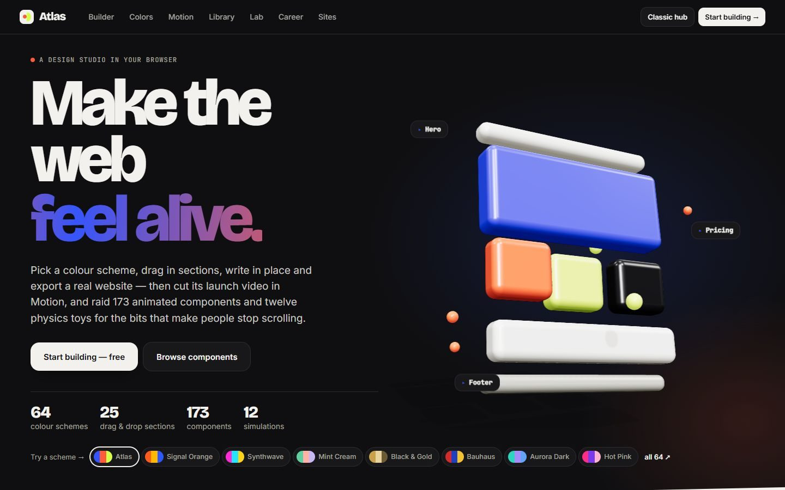
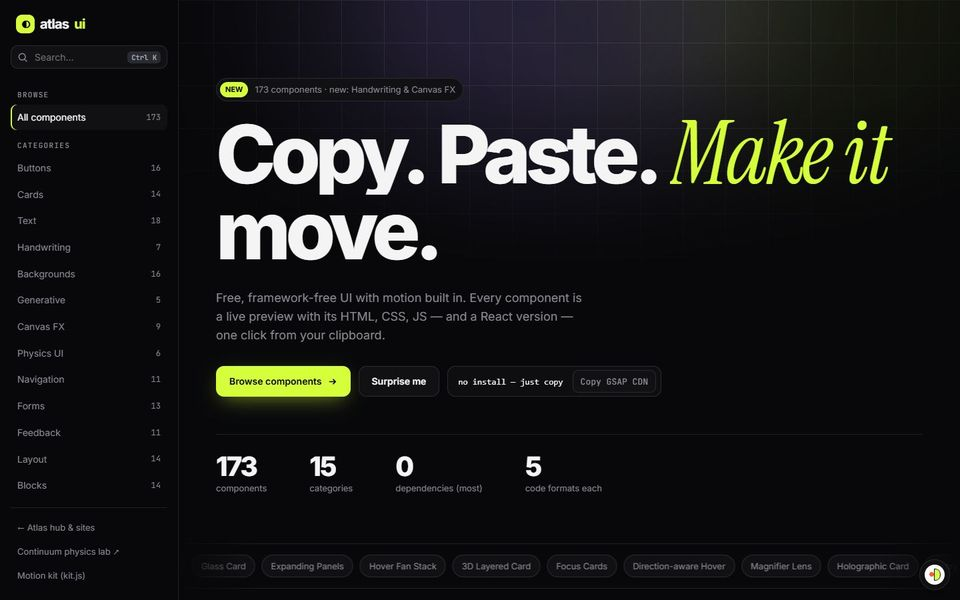
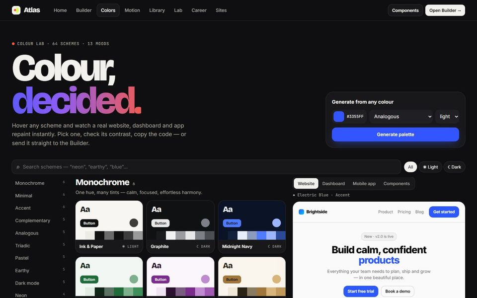
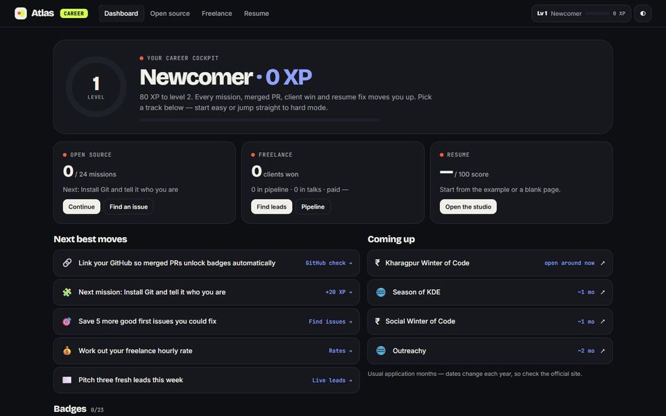
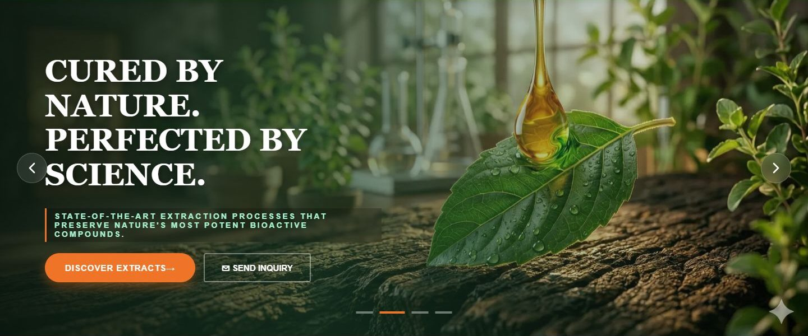

<picture>
  <source media="(prefers-color-scheme: dark)" srcset="assets/header-dark.svg">
  <source media="(prefers-color-scheme: light)" srcset="assets/header-light.svg">
  
</picture>

 

I work where design and engineering meet. I take a product from the first layout to a fast, accessible site that is live on the web: the type scale, the colour system, the motion curves, and the React, Three.js and Node code that ships them.

**[See Atlas, live →](https://atlas-design-lab-nu.vercel.app)**&nbsp;&nbsp;·&nbsp;&nbsp;[Email](mailto:Kavyanshsngh@gmail.com)

 

## Selected work

### Atlas Design Lab

A design studio that runs in the browser, designed and built end to end. It has a drag-and-drop website builder with one-file export, 64 colour schemes with contrast checks and design-token export, a motion editor that renders launch videos, 173 animated components and twelve physics simulations. It is vanilla JavaScript with Three.js and GSAP, follows light and dark mode, works offline and is tested on every page in both themes on desktop and phone.

[Live site](https://atlas-design-lab-nu.vercel.app)&nbsp;&nbsp;·&nbsp;&nbsp;[Components](https://atlas-design-lab-nu.vercel.app/library/)&nbsp;&nbsp;·&nbsp;&nbsp;[Colours](https://atlas-design-lab-nu.vercel.app/colors/)&nbsp;&nbsp;·&nbsp;&nbsp;[Career app](https://atlas-design-lab-nu.vercel.app/career/)

<table>
  <tr>
    <td width="33%"></td>
    <td width="33%"></td>
    <td width="33%"></td>
  </tr>
  <tr>
    <td><b>Library</b> · 173 components, copy as HTML, React or one file</td>
    <td><b>Colors</b> · schemes, harmonies, W3C design tokens</td>
    <td><b>Career</b> · open-source trainer, freelance desk, resume studio</td>
  </tr>
</table>

 

### PuraVida Naturals

An e-commerce storefront for herbal extracts and essential oils: a large catalogue, product management and a calm, photographic look that lets the products lead.

[Live site](https://puravida-omega.vercel.app)&nbsp;&nbsp;·&nbsp;&nbsp;[Code](https://github.com/kaz004/PURAVIDA)

 

## Also built

| Project | What it is |
|---|---|
| [**ChainOps AI**](https://github.com/kaz004/ChainOps) | An operator console for site reliability: service health, SLOs and failure blast radius on one screen, with controlled recovery. |
| [**EPFO Sugam**](https://github.com/kaz004/epfo-sugam) | A mobile-first hackathon prototype that guides people through provident-fund tasks and catches mistakes before they are submitted. |
| [**Dynamic Route Optimizer**](https://github.com/kaz004/DYNAMIC-ROUTE-OPTIMIZER) | Plans multi-stop routes by weighing distance, time, emissions, weather and air quality. |
| [**TravelBuddy**](https://github.com/kaz004/TRAVEL-BUDDY) | An AI travel guide for discovering places and planning trips. |
| [**Smart Parking**](https://github.com/kaz004/Smart-Parking-Management-System) | Computer vision that reads free parking spaces and number plates, with a live React dashboard. |

 

## How I work

**Start from the content.** Every layout begins with the real words and data, not placeholder blocks. 
**Motion with a job.** Animation explains a change of state. One easing curve, a few durations, and it respects reduced-motion settings. 
**Ship it, then prove it.** Real devices, both themes, contrast checks and a clean console before anything is called done.

 

## Toolkit

**Design**&nbsp; Figma · design systems · type and colour · motion 
**Front end**&nbsp; TypeScript · React · Next.js · Three.js · GSAP · Tailwind 
**Back end and ops**&nbsp; Node.js · Express · Python · MongoDB · Docker · Vercel

 

Open to freelance and full-time design-engineering work · <a href="mailto:Kavyanshsngh@gmail.com">Kavyanshsngh@gmail.com</a>
